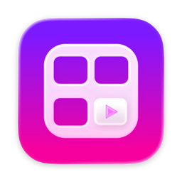

<div align="center">

# GridApp

🇺🇸 **English** · 🇧🇷 [Português](README.pt-BR.md)


-000000?style=for-the-badge&logo=apple&logoColor=white)

[](LICENSE)



> A native macOS app for creating video contact sheets. Built for Apple Silicon with trackpad zoom, click-to-edit frames, and Finder/Shortcuts automation.

</div>

---

## Roadmap & features

What is already built and what is planned next:

- [x] Frame extraction with **AVFoundation** and automatic **FFmpeg / FFprobe** fallback (`MKV`, `AVI`, `WebM`, `FLV`, etc.)
- [x] Pinch-to-zoom preview on the trackpad and direct click-to-edit on any frame
- [x] Sheet aspect presets (`Auto`, `16:9`, `9:16`, `4:5`, `5:4`, `1:1`) and thumbnail ratios (`Adaptar`, `Vídeo`, `16:9`, `4:3`, `1:1`)
- [x] Customizable technical header with font size, line spacing, and alignment controls
- [x] Settings window (`⌘,`) with theme colors, Light/Dark/System mode, and UI density (`Compacto`, `Normal`, `Espaçoso`)
- [x] **Finder Quick Action**, **Apple Shortcuts** (`AppIntents`), and `--headless` CLI mode
- [x] Liquid Glass app icon

## 💻 Requirements 

Before you start, make sure you have:

- A Mac running **macOS 14.0 or later** (**Apple Silicon `arm64`**).
- **Xcode Command Line Tools** (`swiftc`) to build locally with `build_app.sh`.
- *(Optional)* **FFmpeg** via Homebrew for extra formats (`MKV`, `AVI`, `WebM`) and `WebP` export:

```bash
# Install FFmpeg with Homebrew
brew install ffmpeg
```

## 🚀 Installing GridApp

Clone the repo, build the app, and copy it to `/Applications`:

```bash
# Clone the repository
git clone https://github.com/soaresmarcosj1/GridApp.git
cd GridApp

# Build GridApp.app (embeds Resources/Assets.car and AppIcon.icns)
chmod +x build_app.sh
./build_app.sh

# Install into /Applications
rm -rf /Applications/GridApp.app && cp -R GridApp.app /Applications/GridApp.app
```

> [!NOTE]
> If you edit `Resources/AppIcon.icon` in **Icon Composer**, pushing your changes triggers [`.github/workflows/compile-icon.yml`](.github/workflows/compile-icon.yml) to rebuild `Resources/Assets.car` on GitHub Actions (`xcode-27`).

## ☕ Using GridApp

### Desktop app

1. Drop video files into the window (or press `⌘O`).
2. Pinch on the trackpad to zoom (`⌘+`, `⌘-`, `⌘0` for `100%`).
3. Hover and click any frame to fine-tune its timestamp, then click **Aplicar** or **Cancelar**.
4. Adjust layout, header, and colors under **Ajustes & Design** (`⌘1`), or save reusable presets (`⇧⌘M`).
5. Export as **JPEG**, **PNG**, **TIFF**, or **WebP** under **Exportação** (`⌘2`), or batch-export the queue (`⇧⌘E`).

### Keyboard shortcuts

| Shortcut | Action |
| :--- | :--- |
| `⌘O` | Add videos to queue |
| `⌘S` / `⇧⌘S` | Save current contact sheet / Save As |
| `⇧⌘E` | Export selected or all videos in queue |
| `⇧⌘C` | Copy contact sheet to clipboard |
| `⌘R` | Re-capture frames for current video |
| `⌘,` | Open GridApp Settings |
| `⌘1` / `⌘2` | Switch between *Ajustes & Design* and *Exportação* |

### Automation (no UI required)

- **Finder Quick Action:** On first launch, GridApp installs *"Criar Contact Sheet (GridApp)"* in `~/Library/Services` so you can right-click videos or folders in Finder.
- **Apple Shortcuts:** Use the native **"Criar Contact Sheet de Vídeo"** action in the background, with an optional preset name.
- **Command line (`--headless`):**

```bash
# Generate a contact sheet without opening the app window
"/Applications/GridApp.app/Contents/MacOS/GridApp" --headless /path/to/video.mp4
```

## 📫 Contributing to GridApp

To contribute:

1. Fork this repository.
2. Create a branch: `git checkout -b <branch-name>`.
3. Commit your changes: `git commit -m '<message>'`.
4. Push the branch: `git push origin <branch-name>`.
5. Open a pull request.

See the [GitHub pull request guide](https://docs.github.com/en/pull-requests/collaborating-with-pull-requests/proposing-changes-to-your-work-with-pull-requests/creating-a-pull-request) for details.

## 🤝 Contributors

<table>
  <tr>
    <td align="center">
      <a href="https://github.com/soaresmarcosj1" title="Marcos on GitHub">
        <br>
        <sub>
          <b>Marcos (soaresmarcosj1)</b>
        </sub>
      </a>
    </td>
  </tr>
</table>

## 📝 License

GridApp is licensed under the **GNU General Public License v3.0 (GPLv3)**. See [LICENSE](LICENSE) for the full text.

---

<div align="center">
  <sub>Structured with <a href="https://github.com/iuricode/readme-template">iuricode/readme-template</a>.</sub>
</div>
