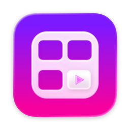

<div align="center">

# GridApp

🇺🇸 [English](README.md) · 🇧🇷 **Português**


-000000?style=for-the-badge&logo=apple&logoColor=white)




> Um app nativo de macOS para criar contact sheets de vídeos. Feito para Apple Silicon, com zoom no trackpad, edição direta de frames e automação no Finder e Atalhos.

</div>

---

## Ajustes e melhorias

O que já funciona e o que está nos planos:

- [x] Extração de frames com **AVFoundation** e fallback automático para **FFmpeg / FFprobe** (`MKV`, `AVI`, `WebM`, `FLV`, etc.)
- [x] Zoom com gesto de pinça no trackpad e clique direto em qualquer frame para editar o tempo
- [x] Proporções de folha (`Auto`, `16:9`, `9:16`, `4:5`, `5:4`, `1:1`) e de miniaturas (`Adaptar`, `Vídeo`, `16:9`, `4:3`, `1:1`)
- [x] Cabeçalho técnico com tamanho de fonte, espaçamento e alinhamento ajustáveis
- [x] Configurações (`⌘,`) com cores de tema, modo Claro/Escuro/Sistema e densidade (`Compacto`, `Normal`, `Espaçoso`)
- [x] **Ação Rápida no Finder**, **Apple Atalhos** (`AppIntents`) e modo terminal `--headless`
- [x] Ícone Liquid Glass compilado em `Assets.car` via GitHub Actions (`xcode-27`)
- [ ] Assinatura e notarização Apple Developer para distribuição

## 💻 Pré-requisitos

Antes de começar, verifique se você tem:

- Um Mac com **macOS 14.0 ou superior** (**Apple Silicon `arm64`**).
- **Xcode Command Line Tools** (`swiftc`) para compilar com `build_app.sh`.
- *(Opcional)* **FFmpeg** via Homebrew para formatos extras (`MKV`, `AVI`, `WebM`) e exportação em `WebP`:

```bash
# Instalar o FFmpeg via Homebrew
brew install ffmpeg
```

## 🚀 Instalando o GridApp

Clone o repositório, compile o app e copie para `/Applications`:

```bash
# Clonar o repositório
git clone https://github.com/soaresmarcosj1/GridApp.git
cd GridApp

# Compilar o GridApp.app (já inclui Resources/Assets.car e AppIcon.icns)
chmod +x build_app.sh
./build_app.sh

# Instalar em /Applications
rm -rf /Applications/GridApp.app && cp -R GridApp.app /Applications/GridApp.app
```

> [!NOTE]
> Se você alterar `Resources/AppIcon.icon` no **Icon Composer**, basta fazer `git push` que o workflow [`.github/workflows/compile-icon.yml`](.github/workflows/compile-icon.yml) recompila o `Resources/Assets.car` no GitHub Actions (`xcode-27`).

## ☕ Usando o GridApp

### Interface do app

1. Arraste vídeos para a janela (ou aperte `⌘O`).
2. Use a pinça no trackpad para dar zoom (`⌘+`, `⌘-` ou `⌘0` para `100%`).
3. Passe o mouse e clique em qualquer miniatura para ajustar o tempo da captura, depois clique em **Aplicar** ou **Cancelar**.
4. Ajuste grade, cabeçalho e cores em **Ajustes & Design** (`⌘1`) ou salve modelos próprios (`⇧⌘M`).
5. Exporte em **JPEG**, **PNG**, **TIFF** ou **WebP** em **Exportação** (`⌘2`), ou exporte a fila em lote (`⇧⌘E`).

### Atalhos de teclado

| Atalho | Ação |
| :--- | :--- |
| `⌘O` | Adicionar vídeos à fila |
| `⌘S` / `⇧⌘S` | Salvar contact sheet atual / Salvar Como |
| `⇧⌘E` | Exportar selecionados ou toda a fila |
| `⇧⌘C` | Copiar contact sheet |
| `⌘R` | Recapturar frames do vídeo atual |
| `⌘,` | Abrir Configurações do GridApp |
| `⌘1` / `⌘2` | Alternar entre *Ajustes & Design* e *Exportação* |

### Automação (sem abrir a janela)

- **Ação Rápida no Finder:** ao abrir o app pela primeira vez, ele instala *"Criar Contact Sheet (GridApp)"* em `~/Library/Services` para usar no clique direito em vídeos ou pastas.
- **Apple Atalhos:** use a ação **"Criar Contact Sheet de Vídeo"** em segundo plano, podendo escolher um modelo salvo.
- **Terminal (`--headless`):**

```bash
# Gerar contact sheet sem abrir a interface
"/Applications/GridApp.app/Contents/MacOS/GridApp" --headless /caminho/do/video.mp4
```

## 📫 Contribuindo para o GridApp

Para contribuir:

1. Faça um fork deste repositório.
2. Crie uma branch: `git checkout -b <nome-da-branch>`.
3. Faça o commit das alterações: `git commit -m '<mensagem>'`.
4. Envie a branch: `git push origin <nome-da-branch>`.
5. Abra um pull request.

Veja também a [documentação do GitHub sobre pull requests](https://docs.github.com/pt/pull-requests/collaborating-with-pull-requests/proposing-changes-to-your-work-with-pull-requests/creating-a-pull-request).

## 🤝 Colaboradores

<table>
  <tr>
    <td align="center">
      <a href="https://github.com/soaresmarcosj1" title="Perfil de Marcos no GitHub">
        <br>
        <sub>
          <b>Marcos (soaresmarcosj1)</b>
        </sub>
      </a>
    </td>
  </tr>
</table>

## 📝 Licença

Este repositório ainda não tem um arquivo de licença. Adicione um arquivo `LICENSE` (como MIT) na raiz do projeto caso queira distribuí-lo em código aberto.

---

<div align="center">
  <sub>Estruturado com base no <a href="https://github.com/iuricode/readme-template">iuricode/readme-template</a>.</sub>
</div>
